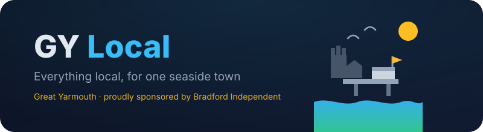
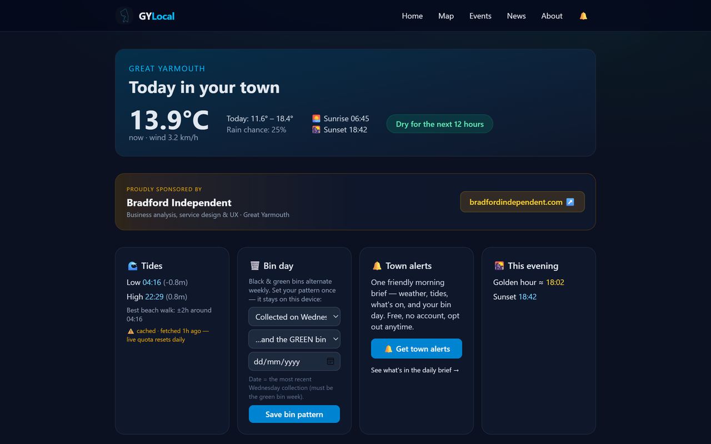
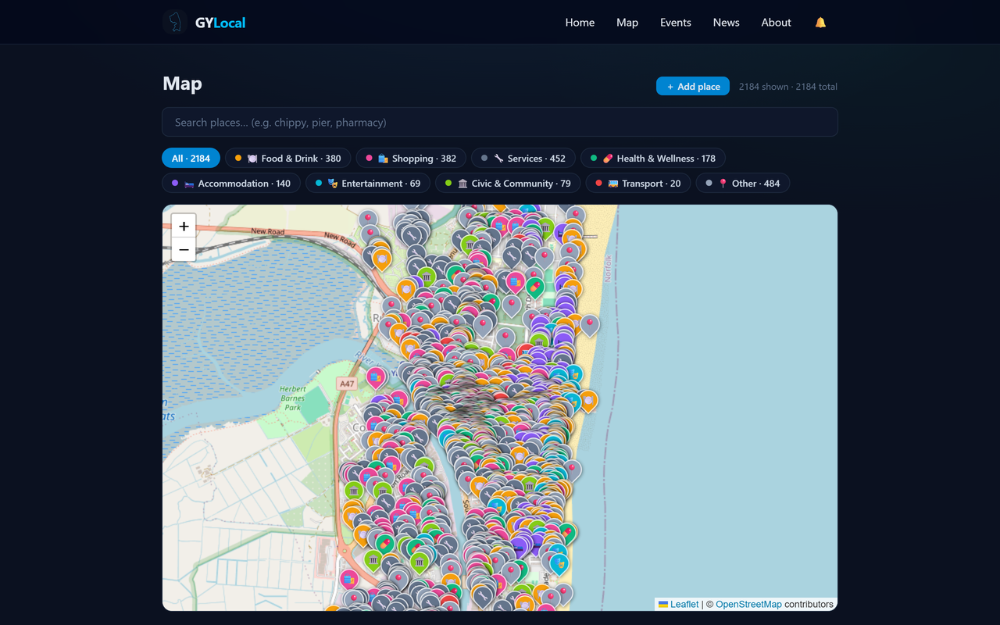
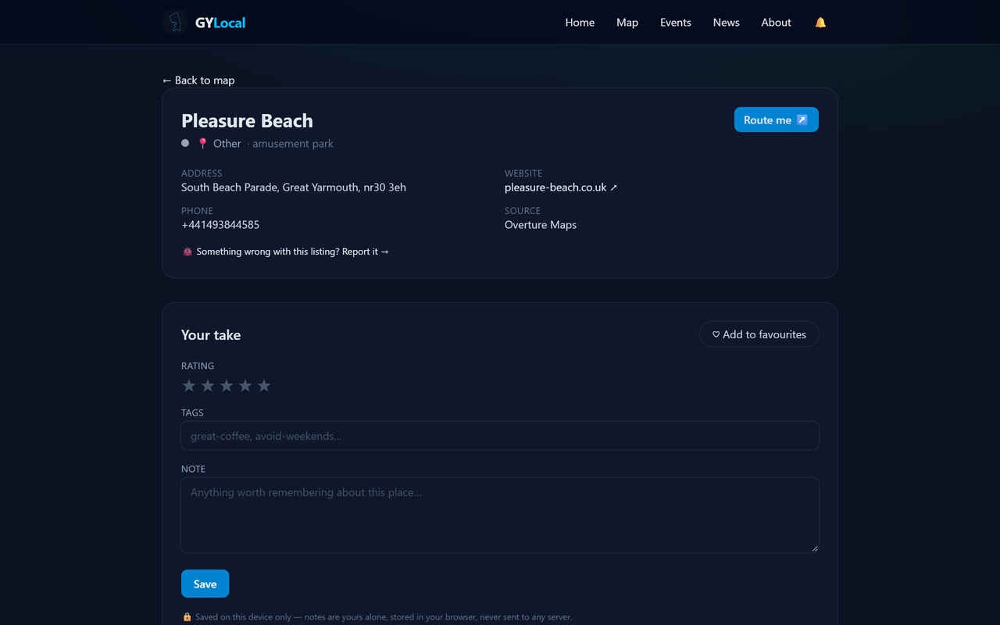
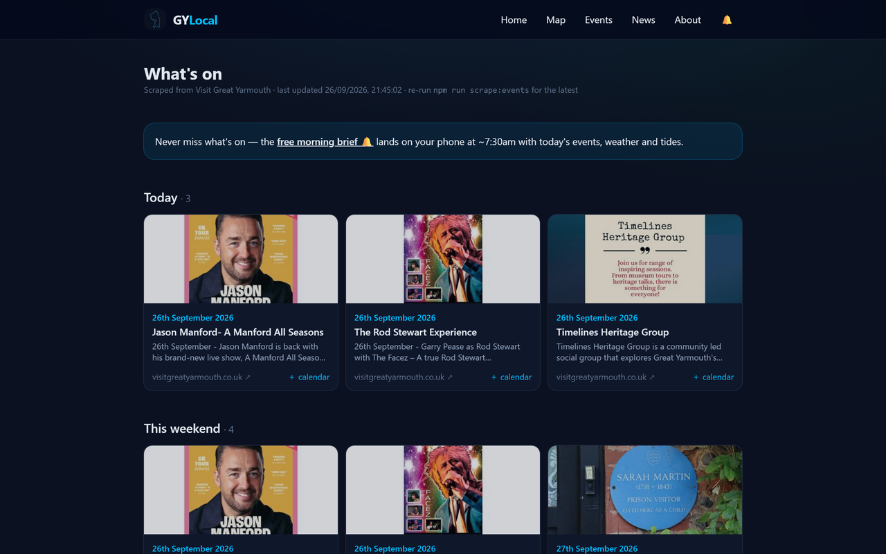
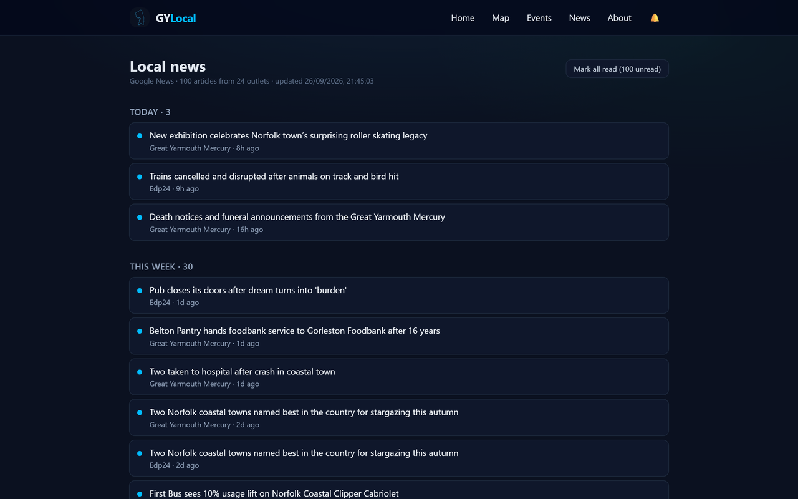
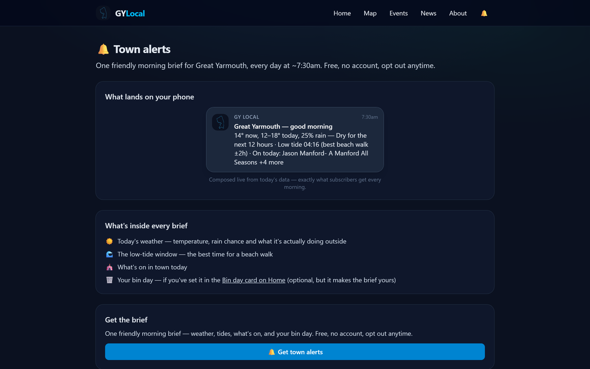
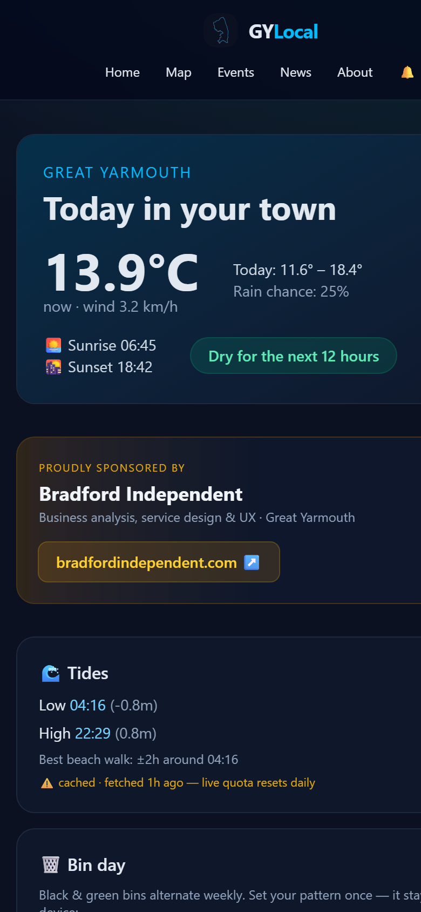
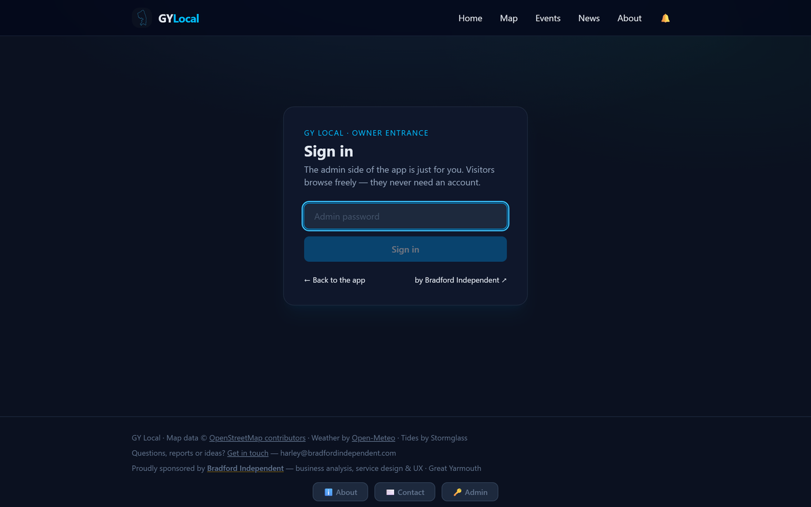

<div align="center">



**The everything-local app for one English seaside town** — places, events, news, tides, weather, the bin day and a morning brief that lands on your phone. Built by someone who lives there.

[](https://gy-local-app.vercel.app)
[]()
[]()
[]()
[]()

**[Live app →](https://gy-local-app.vercel.app)** · [Report a problem](https://gy-local-app.vercel.app/contact?type=report) · [Suggest something](https://gy-local-app.vercel.app/contact?type=suggestion)

</div>

---

## 📸 Take a look

Every image below is a **real capture of the live app** — no mockups, no design files, just screenshots.

| | |
|:---:|:---:|
| <br/><b>The home dashboard</b> — live weather with a rain nowcast, seafront tides, bin day, town alerts | <br/><b>The map</b> — 2,184 places, colour-coded by industry, searchable, filterable |
| <br/><b>Every place has a page</b> — details, routing, and a personal layer (favourites, ratings, tags, notes) that never leaves your device | <br/><b>What's on</b> — events from Visit Great Yarmouth, one-tap calendar downloads |
| <br/><b>Local news</b> — ~100 articles from the Mercury, EDP24, BBC and 20+ outlets, with read-tracking | <br/><b>Town alerts</b> — see exactly what the morning brief will say, then subscribe with one tap |
| <br/><b>Mobile-first</b> — the whole town in one thumb's reach | <br/><b>The owner's side</b> — visitors never log in; one password opens the dashboard |

## What's inside

| | Feature |
|---|---|
| 🗺️ | **A map of 2,184 places** across Yarmouth & Gorleston — every business/POI from Overture Maps, colour-coded by industry, searchable, with filters — and even the 484 "Other" ones carry human subsections (amusement park, car park, campsite…) |
| ⭐ | **A personal layer that stays yours** — ratings, tags, notes and favourites on any place, saved **on your own device** (no account, no tracking, never uploaded) |
| ➕ | **A community layer that's everyone's** — anyone can add a missing place with a pin and category; the owner approves it; then it's public for all, star-marked and colour-coded like the rest |
| 🔔 | **A free morning brief, pushed to your phone** — weather, the low-tide window, what's on and (if you've set it) your bin day, every day at ~7:30am. Web push + VAPID: no accounts, no third-party service, opt out anytime. Preview it before you subscribe |
| 🗓️ | **What's on** — events scraped from Visit Great Yarmouth, grouped by Today / This weekend / Coming up, with one-tap `.ics` calendar downloads |
| 📰 | **Local news** — ~100 articles from the Mercury, EDP24, BBC and 20+ outlets, with read-tracking |
| 🌊 | **A town dashboard** — live weather + rain nowcast ("easing around 14:20"), seafront tides, sunset & golden hour (with a low-tide-near-sunset beach-walk alert), and a bin-day helper that knows the black/green alternation |
| 📬 | **Contact** — enquiries, reports and suggestions email the owner *and* land in an admin inbox |
| 🔐 | **Two sides** — visitors browse freely; the owner signs in for the dashboard (stats, approvals, messages, briefs, data management) |

## It updates itself — and pings you when it's ready

```
   06:20 every morning (Vercel cron)
        ↓
   /api/refresh  — rate-limited, max once per 6h
        ↓
   deploy hook → fresh build
        ↓
   prebuild scrapes Visit GY events + imports 100 news articles
        ↓ (if a source is down? yesterday's data, build never breaks)
   new deployment goes live

   06:30 every morning (Vercel cron)
        ↓
   /api/push/brief — composes today's brief from live data
        ↓
   lands on every subscriber's phone: "Great Yarmouth — good morning"
```

No human in the loop. Tides and weather are fetched live at request time (cached — the whole stack stays inside every free tier). Dead subscriptions are pruned automatically.

## Where the data comes from

| Data | Source | Licence note |
|---|---|---|
| Places & POIs | [Overture Maps](https://overturemaps.org/) | CDLA-Permissive |
| Map tiles & routing | [OpenStreetMap](https://www.openstreetmap.org/copyright) | ODbL, attribution required |
| Events | [Visit Great Yarmouth](https://www.visitgreatyarmouth.co.uk/whats-on/events-calendar) | scraped gently — 1 fetch/day, links back |
| News | Google News RSS for `great_yarmouth` | personal, non-commercial reader use |
| Tides | [Stormglass.io](https://stormglass.io) | free tier |
| Weather & rain | [Open-Meteo](https://open-meteo.com/) | CC BY 4.0 |
| Your data | Turso (libSQL), region `aws-eu-west-1` | only what's shared: community submissions, contact messages, brief subscriptions |

## Built with

**Next.js 15 · React 19 · Tailwind CSS · Leaflet · Turso (`@libsql/client/web`) · web-push (VAPID) · Vercel (hosting + cron) · cheerio scrapers**

One rule held throughout: **every dependency must have a viable free tier.** The result is a deployed, self-updating, database-backed app — push notifications included — for **£0/month**.

## Run one for your own town

This isn't just an app — it's a **pattern**: one town, open data, free infrastructure, one maintainer. To fork it for somewhere else:

```bash
git clone https://github.com/Harleysstory/gy-local-app.git
cd gy-local-app && npm install

# 1. Free accounts: Turso (database) + Stormglass (tides, if you're coastal)
#    Create .env.local with TURSO_DATABASE_URL, TURSO_AUTH_TOKEN,
#    STORMGLASS_API_KEY, ADMIN_PASSWORD
node scripts/apply-schema.mjs            # 2. create the tables
node scripts/import-overture.mjs <geojson>  # 3. your town's places (Overture / OSM)
node scripts/scrape-events.mjs           # 4. point the scraper at YOUR events site
npx web-push generate-vapid-keys        # 5. free push keys for the morning brief
npm run dev                              # 6. → http://localhost:3000
```

Then swap the constants in `src/lib/` (town centre, bounding box, category map) and the news feed URL in `scripts/import-news.mjs`. Deploy free with `vercel`. The full ops runbook — Windows ARM64 notes, deploy gotchas, every command — lives in **[DEV.md](DEV.md)**.

## Project layout

```
src/app/            pages: /, /map, /place/[id], /events, /news, /alerts, /contact, /login, /admin
src/app/api/        push (subscribe · brief · test), contact, admin, refresh (cron)
src/lib/            town constants, pins, auth, weather/tides/bins logic, VAPID push, Turso client
src/components/     map views, picker, cards, alerts card + live brief preview, admin dashboard
scripts/            overture import · event scraper · news importer · GTFS filter (buses, parked)
db/schema.sql       notes, favourites, manual places (approval queue), messages, push subscriptions, settings
docs/               banner, screenshots, research notes
```

## Roadmap

- 🚌 **Buses** — BODS GTFS feed is spec'd and the filter script is ready; waiting on a free API key
- 📷 Seafront webcams · 💾 one-click data export · 🗂️ saved deals & links
- The honest roadmap: whatever real daily use asks for next

---

<div align="center">

### About

Built in Great Yarmouth by **[Harley Bradford](https://www.bradfordindependent.com)** —
**[Bradford Independent](https://www.bradfordindependent.com)** · business analysis, service design & UX

*Code: MIT (see [LICENSE](LICENSE)). Data belongs to its sources — see the credits table.*

</div>
